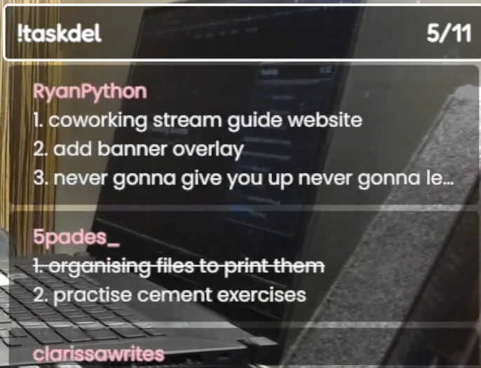

# Multi-Task Widget Infinity

A Twitch chat task list overlay for your stream. Viewers add, finish and focus their own tasks through chat commands, and the list scrolls on screen as a browser source. It runs entirely in the browser and needs no Streamer.bot or server; tasks are stored in the browser's IndexedDB.

## Setup

1. Download or clone this repository.
2. Open `auth.js` and fill in:
   - `channel`: your Twitch channel name.
   - `username`: the bot account's username.
   - `oauth`: the bot account's OAuth token (`oauth:xxxxxxxxxxxx`).
3. Adjust `configs.js` to taste (see [Configuration](#configuration)).
4. In OBS (or any streaming software), add a **Browser Source**, tick **Local file** and choose `index.html`.

Keep `auth.js` private; never share it or show it on stream.

## Usage

Tasks are referred to by their number on the list or by their exact text. Several tasks can be given at once by separating them with `;` or `,` (for example `!task read; write; code`), and `!done`/`!remove`/`!undone` also accept space-separated numbers (`!done 1 3`). When a command needs a task and you don't give one, the widget uses your focused task, or your only unfinished task.

### Viewer commands

| Command | Description |
| --- | --- |
| `!task <task>` | Add one or more tasks |
| `!log <task>` | Add a task that is already completed |
| `!edit <number> <new task>` | Edit a task (number optional if you have a focused task) |
| `!done <task>` / `!done all` | Mark tasks as complete |
| `!undone <task>` | Mark completed tasks as incomplete |
| `!remove <task>` | Remove tasks |
| `!focus <task>` / `!now <task>` | Focus a task, adding it first if it doesn't exist |
| `!focused` | Show your focused task |
| `!unfocus` | Unfocus your task |
| `!next <task>` | Complete your focused task and focus the next one (adds it if new) |
| `!check [@user]` | List pending tasks (yours or another user's) |
| `!completed [@user]` | List completed tasks |
| `!list [separator] [@user]` | List task names only, e.g. `!list ;` |
| `!clearmydone` | Clear your own completed tasks |
| `!count [@user]` | Show how many tasks you (or a user) have completed |
| `!boardcount` | Show how many tasks everyone has completed |
| `!help` | Show the help message |
| `!botcred` | Show bot credits |

### Moderator commands

| Command | Description |
| --- | --- |
| `!adel @user` | Delete all of a user's tasks |
| `!settaskcount @user <number>` | Set a user's completed task count |

### Streamer commands

| Command | Description |
| --- | --- |
| `!cleardone` | Clear everyone's completed tasks |
| `!clearns` | Clear all tasks except the streamer's |
| `!cleartasks` / `!clearall` | Clear all tasks |
| `!clearold <days>` | Clear tasks that are at least `<days>` days old |
| `!countold <days>` | Count tasks that are at least `<days>` days old |
| `!setboardcount <number>` | Set the total completed count |
| `!resetboardcount` | Reset the total completed count |
| `!resetuserscount` | Reset every user's completed count |
| `!clearallnoregrets` | Wipe all tasks and counts |
| `!clearlocalstorage` | Remove old localStorage data |
| `!transferdata` | Move old localStorage data into IndexedDB |

Most commands have aliases (for example `!add`, `!todo` and `!a` all add a task). The full list for every command is in the `commands` section of `configs.js`, where you can also add or remove aliases.

## Configuration

Everything is configured in `configs.js`:

- **`settings`**: chat replies on/off, per-user task limit, task name (e.g. "task" or "goal"), separators, quote characters, character limit, fonts and hiding the list when empty.
- **`animation`**: scroll speed and the header titles the widget rotates through.
- **`styles`**: colours, opacity, borders, padding and fonts for the list, header, tasks, completed tasks and the focused task.
- **`commands`**: every chat command and its aliases, plus `additionalCommands` for simple custom text replies.
- **`responses`**: every chat reply. Placeholders such as `{user}`, `{task}`, `{taskName}` and `{doneCount}` are filled in automatically.

## Credits

Created by [RythonDev](https://www.twitch.tv/RythonDev) ([GitHub](https://github.com/liyunze-coding), [X](https://x.com/rythondev), [Ko-fi](https://ko-fi.com/rython)).

## License

[MIT](./LICENSE)
